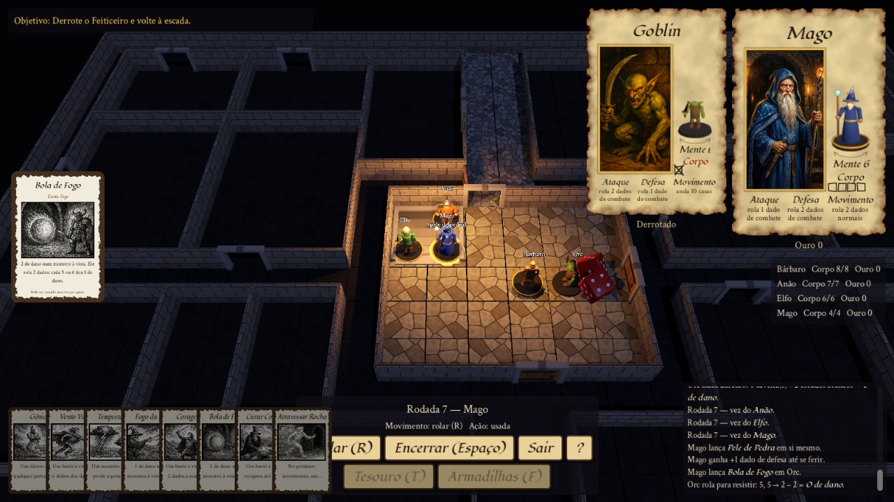

# HeroQuest Simulator

Recriação digital em 3D do jogo de tabuleiro **HeroQuest** (MB Games / Milton Bradley, 1989),
feita em **Godot 4.7** (GDScript, renderizador Forward+). Quatro heróis exploram masmorras de
quadrados, enfrentam os monstros de Zargon, lançam feitiços e juntam ouro e equipamento numa
campanha. Dá para jogar sozinho, em várias pessoas no mesmo computador ou online.



> Projeto de fã, sem fins lucrativos e sem ligação com a Hasbro, a Avalon Hill ou a Games Workshop.
> HeroQuest é marca registrada da Hasbro. Para jogar, tenha o seu exemplar do jogo.

## O que já funciona

- **Regras do jogo base**: movimento por dados, combate com dados de caveira/escudo, linha de
  visão, névoa de guerra (salas e corredores), portas e portas secretas, busca de tesouro e de
  armadilhas, armadilhas (fosso, lança, bloco que cai, baú), desarme, baralho de tesouro e
  monstro errante.
- **Magia**: escolha das escolas (Ar, Fogo, Terra e Água) entre o Mago e o Elfo, os 12 feitiços dos
  heróis e os do Caos, com a mira pela linha de visão.
- **Zargon**: IA dos monstros (ataca se alcança, anda e ataca, ou avança) e o Bruxo do Caos lançando feitiços.
- **Quests**: The Trial, The Rescue of Sir Ragnar e Barak Tor (mapas oficiais importados do
  [HeroScribe](https://github.com/heroscribe/heroscribe)), com objetivo, introdução e notas do livro.
- **Campanha**: ouro e equipamento passam de uma quest para a outra, a armeria entre as quests,
  o save no meio da quest e o título de Campeão.
- **Online**: lobby de salas com senha opcional, um assento por herói e servidor autoritativo.
  Os clientes reaplicam os comandos e conferem o estado por hash.
- **Apresentação**: tabuleiro, móveis e miniaturas em 3D, dados com física que caem na mesa,
  cartas no estilo da edição europeia, fichas de personagem e sons sintetizados.

## Como jogar

### Executáveis

Ainda não há versão publicada. Para gerar a sua, veja [Exportar](#exportar).

### Pelo código

1. Instale o [Godot 4.7](https://godotengine.org/download) (versão padrão, sem .NET).
2. Clone o repositório:
   ```bash
   git clone https://github.com/MarioTrazzi/heros-quest-simulator.git
   ```
3. Abra a pasta no Godot e aperte **F5**, ou rode pelo terminal:
   ```bash
   godot --path heros-quest-simulator
   ```

No menu, escolha **Nova campanha** para jogar no mesmo computador, **Treino avulso** para uma
partida solta ou **Jogar online** para entrar num servidor.

**Controles:** clique para mover, atacar, abrir portas e usar cartas. `R` rola o movimento, `Espaço`
encerra a vez, `T` procura tesouro e `F` procura armadilhas. A câmera gira com o botão direito
arrastado, anda com `WASD`/setas ou com o botão do meio, e a roda do mouse dá o zoom. O botão `?` mostra a ajuda.

## Servidor online

O servidor é o próprio projeto rodando sem janela:

```bash
godot --headless --path . -- --server          # porta 8765; PORT e HQ_DATA_DIR mudam a porta e a pasta das salas
```

Também dá para subir o servidor com Docker (serve para Railway, VPS etc.; as salas ficam no volume `/data`):

```bash
docker build -t heroquest-server .
docker run -d -p 8765:8765 -v hq-data:/data heroquest-server
```

No jogo, entre em **Jogar online** e use `ws://localhost:8765`, ou `wss://seu-dominio` se o servidor estiver atrás de HTTPS.
Cliente e servidor precisam estar na mesma versão do código.

## Testes

```bash
godot --headless --path . --import                         # registra as classes
godot --headless --path . res://tests/rules_tests.tscn     # regras (sai com código ≠ 0 se falhar)
godot --headless --path . res://tests/game_smoke.tscn      # abre uma partida e joga por código
godot --headless --path . res://tests/campaign_smoke.tscn  # menu → campanha → armeria → quest → save
godot --headless --path . res://tests/net_smoke.tscn       # servidor + 2 clientes
```

## Exportar

Os modelos de exportação do Godot precisam estar instalados. O `export_presets.cfg` fica fora do git:
crie os presets "macOS" e "Windows" em **Projeto → Exportar** e acrescente `*.xml` ao filtro de
recursos não importados (os mapas do HeroScribe são lidos em tempo de execução).

```bash
godot --headless --path . --export-release "macOS" build/mac/HeroQuest.zip
godot --headless --path . --export-release "Windows" build/windows/HeroQuest.exe
```

## Organização

| Pasta | Conteúdo |
|---|---|
| `scripts/logic/` | Motor de regras puro, sem nada de 3D: tabuleiro, caminho, visão, dados, combate, magia, exploração, IA, turno e `Match` (partida reproduzível por comandos) |
| `scripts/view/`, `scenes/` | Apresentação: tabuleiro 3D, miniaturas, câmera, dados, HUD e cartas; telas de menu, campanha e lobby |
| `scripts/net/`, `server/` | Protocolo e cliente online; servidor autoritativo e as salas gravadas |
| `autoload/` | `GameData`, `Session`, `Net`, `Settings`, `Sfx` |
| `data/` | Heróis, monstros, armeria, feitiços, tesouro, móveis e tabuleiro em JSON; quests em `data/quests/` |
| `referencias/heroscribe/` | Mapas das quests no formato do HeroScribe, incluindo as 15 do livro base europeu |
| `assets/` | Modelos, texturas, retratos, arte das cartas e fontes |
| `tools/` | Scripts do Blender (`tools/blender/`) e dos geradores de arte e texturas |
| `tests/` | Testes de regra e testes de fumaça, que rodam sem janela |
| `docs/` | [Regras do HeroQuest](docs/01-regras-heroquest.md) e [arquitetura e roteiro](docs/02-arquitetura-godot.md) |

O [`AGENTS.md`](AGENTS.md) explica cada parte e as decisões tomadas onde o livro de regras é ambíguo.
Os campos `_uncertain` dos JSON ainda precisam ser conferidos com o livro físico.

## Roteiro

- [x] Motor de regras com testes
- [x] Tabuleiro 3D jogável, combate, IA de Zargon e dados 3D
- [x] Exploração: névoa, buscas, armadilhas, tesouro e monstro errante
- [x] Magia dos heróis e do Caos
- [x] Quest completa, importador do HeroScribe e campanha com armeria e save
- [x] Polimento: sons, opções, pular fosso e espólio do herói morto
- [x] Arte 3D (Blender via MCP), cartas e retratos pintados
- [x] Multijogador online
- [ ] As outras 11 quests do livro base (os mapas já estão em `referencias/heroscribe/hqbase_eu`)
- [ ] Refazer a arte provisória (cartas, temas e móveis de papel) no estilo dos retratos

## Créditos

- Jogo original: HeroQuest © 1989 Milton Bradley / Games Workshop; marca da Hasbro.
- Mapas das quests: [HeroScribe](https://github.com/heroscribe/heroscribe).
- Fontes: [Fondamento](https://fonts.google.com/specimen/Fondamento) e
  [Crimson Text](https://fonts.google.com/specimen/Crimson+Text), sob a SIL Open Font License
  (`assets/fonts/OFL-*.txt`).
- Retratos e parte da arte foram gerados por IA (Higgsfield e OpenAI). As ilustrações foram
  desenhadas de novo, sem usar a arte original como entrada.
- Motor: [Godot Engine](https://godotengine.org).
